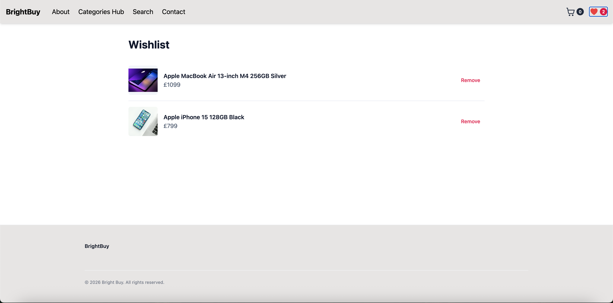
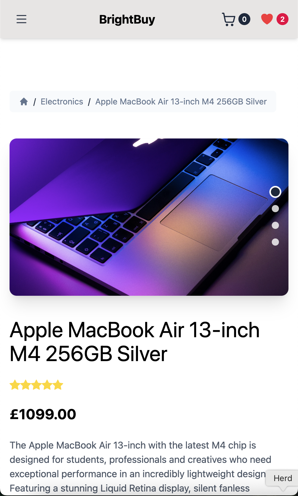
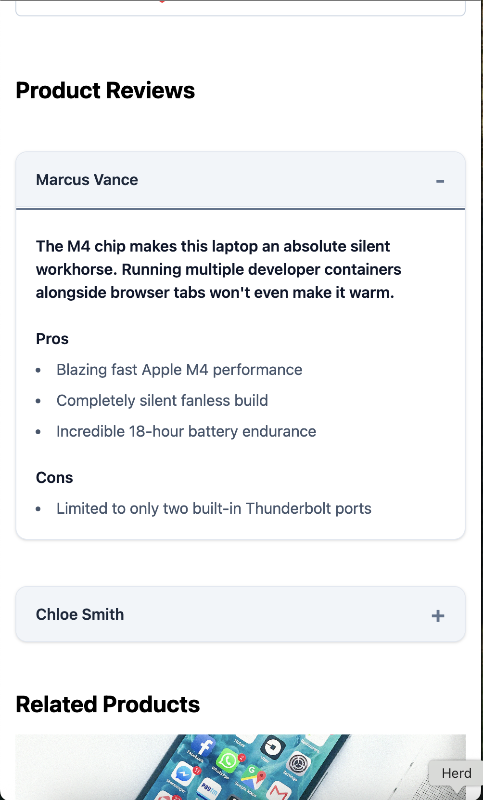
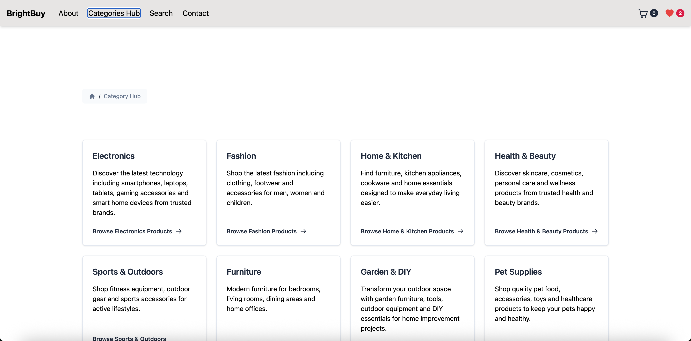
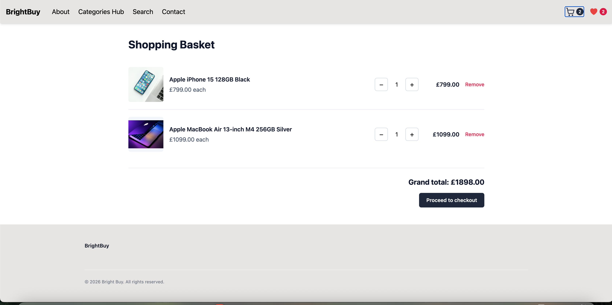
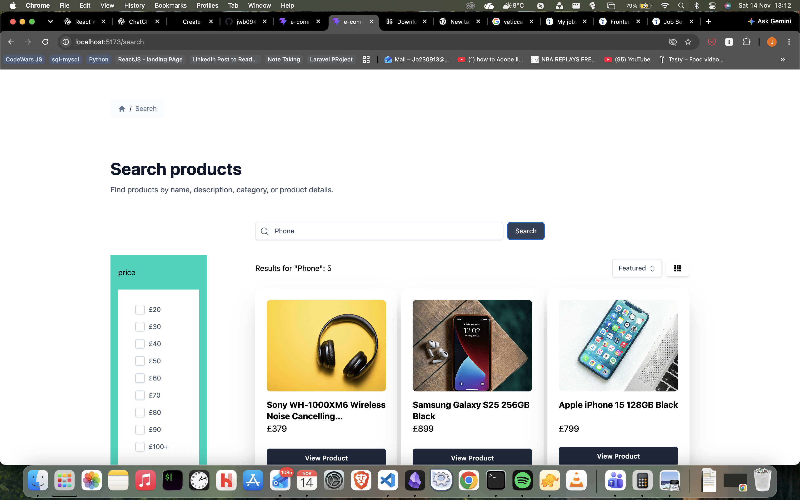
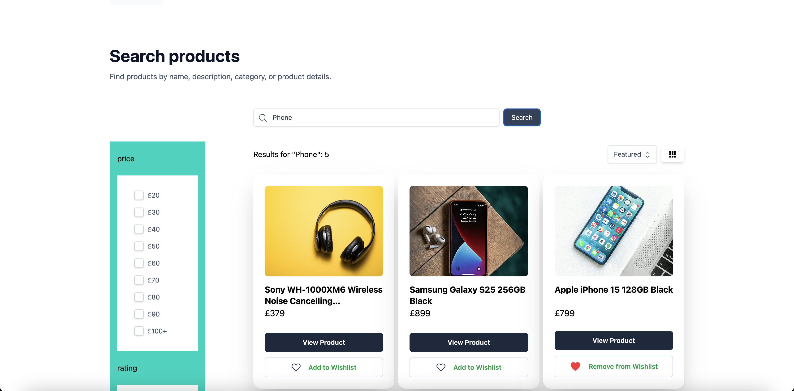
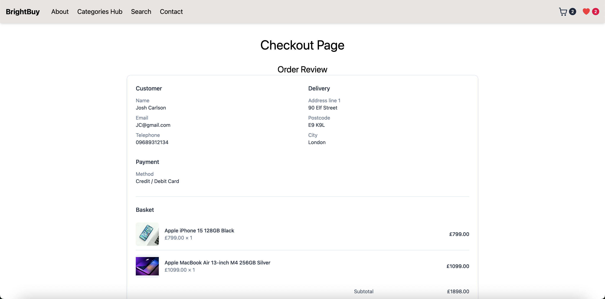
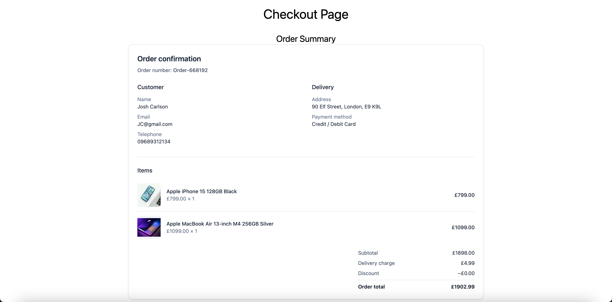
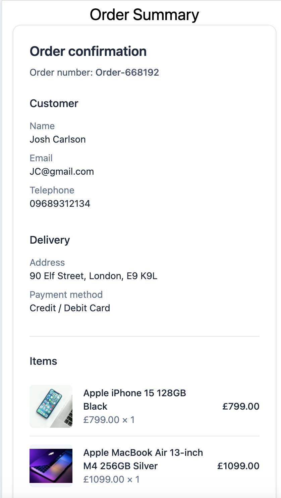

# 🛍️ E-CommerceApp

A responsive React storefront for browsing products, exploring categories, searching and filtering the catalogue, and stepping through a shopping basket and checkout flow. The app uses local JavaScript data to demonstrate common e-commerce pages, reusable UI, and shared client-side state.

---

## 📋 Table of Contents

* [About](#-about)
* [Features](#-features)
* [Application Preview](#-application-preview)
* [Technology Stack](#️-technology-stack)
* [Application Structure](#-application-structure)
* [Product Data and Relationships](#-product-data-and-relationships)
* [Routing and State](#-routing-and-state)
* [Installation](#-installation)
* [Running the Application](#️-running-the-application)
* [Project Architecture](#️-project-architecture)
* [Current Scope](#-current-scope)
* [Future Improvements](#-future-improvements)
* [Learning Objectives](#-learning-objectives)

---

## 📖 About

E-CommerceApp is a frontend-only online store built with React. Visitors can browse product collections, explore category and product pages, search the catalogue, and manage a basket or wishlist. A multi-step checkout presents customer, delivery, payment, review, and order-summary screens.

The project is a learning and portfolio application. Product, category, review, and FAQ content is stored in local JavaScript files; there is no connected backend or database.

---

## ✨ Features

### 🛒 Product Discovery

* Homepage collections for featured, sale, best-rated, best-seller, and latest products
* Category hub and category-specific product listings
* Search across product names, descriptions, attributes, categories, and tags
* Filter products by price, rating, and sale status
* Sort results and switch between grid and list views
* Paginated product listings

### 🧾 Product Details

* Product information, pricing, ratings, tags, and specifications
* Scrollable image gallery with selectable image indicators
* Product reviews and related product suggestions

### 👤 Shopping and Checkout

* Add products to a basket and adjust quantities
* Add and remove products from a wishlist
* Multi-step checkout with customer, delivery, and payment forms
* Order review and confirmation summary

### 📄 Store Pages

* About, contact, FAQ, login, registration, profile, and not-found pages
* Shared header, footer, and page layout components
* Responsive layouts for desktop and smaller screens

---

## 📸 Application Preview

The screenshots below show the application as captured on 14 November 2026.

<p align="center">
  
</p>
<p align="center">
  
</p>
<p align="center">
  
</p>
<p align="center">
  
</p>
<p align="center">
  
</p>
<p align="center">
  
</p>
<p align="center">
  
</p>
<p align="center">
  
</p>
<p align="center">
  
</p>
<p align="center">
  
</p>

---

## 🛠️ Technology Stack

### Frontend

* React
* JavaScript (ES modules)
* React Router
* React Context API and React Hooks
* Tailwind CSS
* Sass

### Development Tools

* Vite
* npm

---

## 📁 Application Structure

The source is organized around routed pages, reusable components, shared state, local data, and product helpers.

```text
src/
├── assets/          # Icons and component styles
├── components/      # Layout, checkout, contact, and shopping UI
├── context/         # Basket, wishlist, and filter providers
├── data/            # Products, categories, reviews, FAQs, and filter options
├── pages/           # Routed storefront pages
├── reducer/         # Basket and wishlist state transitions
├── utils/            # Product lookup, search, sorting, filtering, and pagination
├── App.jsx           # Application routes
└── main.jsx          # React entry point and context providers

docs/
└── images/           # README preview screenshots
```

---

## 🗂️ Product Data and Relationships

The storefront uses local JavaScript datasets rather than a database or API. Product entries refer to categories by `category_id`, and product review records refer to products by `product_id`.

```text
Category
 └── Products (category_id)
      └── Product Reviews (product_id)

Basket
 └── Items (product_id, quantity)

Wishlist
 └── Product IDs
```

The primary data files are `src/data/Products.js`, `src/data/Categories.js`, `src/data/ProductReviews.js`, and `src/data/Faqs.js`.

---

## 🧭 Routing and State

React Router maps the storefront pages to client-side routes:

| Route | Page |
| --- | --- |
| `/` | Home |
| `/categories` | Category hub |
| `/category/:cat_slug` | Category listing |
| `/product/:product_id/:product_slug` | Product details |
| `/search` | Search results |
| `/basket` | Basket |
| `/wishlist` | Wishlist |
| `/checkout` | Checkout |
| `/about`, `/contact-us`, `/faqs` | Store information |


Basket and wishlist state is managed with React reducers and context providers. Filter selections are shared through a context provider. This state is held in the browser session and is not persisted to a server or database.

---

## 🚀 Installation

### 1. Open the Project

```bash
cd Learning/Reactjs/Projects/E-CommerceApp
```

### 2. Install Dependencies

```bash
npm install
```

---

## ▶️ Running the Application

Start the Vite development server:

```bash
npm run dev
```

Open the local URL printed in the terminal to view the storefront.

To create a production build:

```bash
npm run build
```

---

## 🏗️ Project Architecture

The app starts in `src/main.jsx`, which mounts the React application and wraps it in the router and shared state providers. `src/App.jsx` declares the routes. Page components compose reusable UI and use helpers from `src/utils/functions.js` to query the local data.

```text
main.jsx
   ↓
Router and shared providers
   ↓
App routes
   ↓
Page components
   ↓
Reusable components and local data helpers
```

---

## 📌 Current Scope

This repository demonstrates a client-side storefront. It does not currently include a backend, database, real payment processing, server-side authentication, or persistent basket and wishlist storage. The login, registration, and profile routes are frontend pages rather than a complete account system.

---

## 🔮 Future Improvements

Potential next steps include:

* [ ] Connect the catalogue to a backend API
* [ ] Persist basket and wishlist data between sessions
* [ ] Add real account registration and authentication
* [ ] Integrate a payment provider and order storage
* [ ] Add automated unit and browser tests
* [ ] Improve accessibility and loading/error states

---

## 📚 Learning Objectives

This project provides practice with:

* Building a multi-page React application
* Creating reusable components and layouts
* Managing shared state with Context API and reducers
* Implementing client-side routing
* Searching, filtering, sorting, and paginating product data
* Building a responsive storefront and multi-step checkout flow
* Organizing local data and reusable utility functions

---
